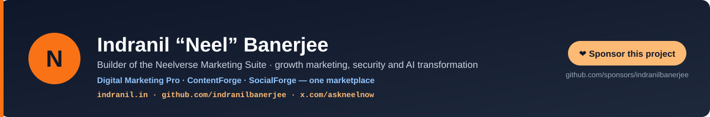

# Neel's Plugin Marketplace

> **You run marketing for a single brand, an agency portfolio, or a content team — and you want the same depth across every brand, every article, every campaign, every film, with no per-platform lock-in. You don't want to learn six different "AI marketing" SaaS UIs that all charge per-seat per-month.**

Install four open-source plugins from one marketplace: strategy, long-form content, social and video. The same skills install natively on **Claude Code**, **Anthropic Cowork**, **OpenAI Codex**, **Cursor 2.5+**, **GitHub Copilot CLI**, **Google Antigravity 2.0**, **Hermes Agent**, **OpenClaw**, and **Grok** (xAI Build CLI) + 35+ additional Agent Skills platforms — via the Agent Skills open standard. Zero global hooks, zero auto-connecting MCP servers, MIT-licensed, no telemetry, no seats.

[](CHANGELOG.md)
[](LICENSE)
[](#available-plugins)
[](#which-plugin-do-i-need)
[](#whats-new)
[](#platform-compatibility)

[](https://github.com/sponsors/indranilbanerjee)

> 🆕 **October 27, 2026: marketplace v3.57.4.** Digital Marketing Pro picks AI models by job from each provider's live list, not by a stored name; speech models join the shared registry as pins that expire; every privacy-law jurisdiction re-read at its source. [What's new](#whats-new) · [Changelog](CHANGELOG.md)

A custom plugin marketplace by [Indranil Banerjee](https://indranil.in) · [LinkedIn](https://www.linkedin.com/in/askneelnow/) · [X](https://x.com/askneelnow). Agent Skills was donated to the Agentic AI Foundation December 2025; adopted by **41+ agent products** by June 2026.

---

## Which plugin do I need?


| Your job-to-be-done | Install | What's in the box |
|---|---|---|
| **Run end-to-end brand-strategy engagements across a portfolio** (agencies, in-house, consultants) | [`digital-marketing-pro`](https://github.com/indranilbanerjee/digital-marketing-pro) | 164 skills · 24 agents · 12-Part Strategy Flow · 6-platform AEO/GEO · agent-readiness audit · EU AI Act Article 50 · Cowork-team-persistent · multi-brand · multi-jurisdiction compliance |
| **Produce publish-ready long-form content** (blog posts, white papers, case studies, executive briefs) | [`contentforge`](https://github.com/indranilbanerjee/contentforge) | 22 skills · 13 agents · 10 quality gates · 43-pattern AI humanizer · fact-checker · run auditor · lifecycle loop (audit→refresh→measure→plan) · real `.docx` output · C2PA signing |
| **Produce social media assets at agency scale** (carousels, single-image posts, AI image / video creatives) | [`socialforge`](https://github.com/indranilbanerjee/socialforge) | 21 skills · 5 agents · 18 commands · research-month · asset-first compositing · AI image + video via your connected providers · delivery audit · C2PA signing |
| **Make a film or a brand video from your own footage** (family and milestone films, tributes, brand films, explainers, ads, pharma and BFSI videos) | [`cutforge`](https://github.com/indranilbanerjee/cutforge) | 13 skills · 4 reviewer agents · a tested Remotion + ffmpeg + Python engine (48 tools) · timing derived from the measured narration · speech-to-text-verified voice · designed sound · nine QC layers · AI only where no camera was |

**The four plugins are complementary, not overlapping.** A typical agency workflow: DMP for strategy + campaign planning, ContentForge for the long-form articles a campaign produces, SocialForge for its month of social assets (including short AI video creatives), CutForge for the brand film, explainer or ads cut from real footage. Each plugin is self-contained and keeps its own brand setup, so set the brand up once in each plugin you use.

### What these plugins will never do

- **Install software on their own.** A missing package prints the exact install command for you to run.
- **Send, publish or spend without your say-so.** Live writes wait for your typed `yes` (Digital Marketing Pro also requires a single-use approval record for that exact request), and SocialForge shows a live quote before any paid image or video generation and waits for "go". CutForge's paid voice and AI-art tools refuse to run without a `GO_AHEAD.txt` and stop at the budget cap you set.
- **Ask for an API key in the chat.** Keys come from environment variables.
- **Connect to anything you did not set up.** No MCP server ships enabled and no hooks run.
- **Put AI on a real person's face.** CutForge generates only what no camera captured and refuses AI inputs that contain a face.
- **Remove or hide AI watermarks.** AI involvement is disclosed, with C2PA provenance where the format supports it.
- **Depend on each other.** Each plugin is self-contained and useful alone.

### What it costs

- **The four plugins are free** (MIT-licensed).
- **Model usage (tokens).** On a subscription (Claude Pro, Max, Team or Enterprise in Claude Code or Cowork; a ChatGPT plan in Codex; a Cursor or Copilot plan; the same goes for other hosts' plans) the tokens count against your plan's usage limits instead of being billed per token; check your plan for any optional extra-usage billing. Only pay-as-you-go API-key users pay per token. Context (the skill listing, a skill's instructions; in Hermes, the 207 skill names of the combined listing) uses context window and usage allowance for everyone, and money only for API users.
- **Services you connect with your own keys** (image and video generation, voice and speech-to-text, SEO and data APIs, ad, email and CRM platforms, Google Drive, Airtable) are billed by those providers, whatever plan you are on. SocialForge quotes each paid generation before it runs; CutForge logs every paid call and stops at your cap.
- **CutForge renders on your own machine** (Remotion, ffmpeg and Python), so there are no cloud render fees. Remotion itself is free for individuals and companies of up to 3 people; larger companies need a Remotion Company License for commercial work.

---

## Quick start

### 1. Add this marketplace to Claude

```
/plugin marketplace add indranilbanerjee/neels-plugins
```

In Cowork: Settings → Plugins → Add Marketplace → paste `indranilbanerjee/neels-plugins`.

### 2. Browse available plugins

```
/plugin list neels-plugins
```

### 3. Install a plugin

```
/plugin install contentforge@neels-plugins
```

(Replace `contentforge` with `digital-marketing-pro`, `socialforge` or `cutforge` as desired.)

> **On a 200k context window?** Claude Code lists every installed skill in a budget of 1% of the context window. With all four plugins installed, a 200k window has room for skill names only, so Claude can't see what each skill does. Add `"skillListingBudgetFraction": 0.05` to your Claude Code `settings.json` to fix that. On a 1M window the full list already fits.

### 4. Stay current — turn auto-update on (recommended)

**Third-party marketplaces have auto-update OFF by default in Claude Code.** When we ship a new ContentForge / DM Pro / SocialForge / CutForge release, you will not be notified — you will keep running whatever version you installed first.

To get future updates automatically: open `/plugin`, go to the **Marketplaces** tab, find `neels-plugins`, and toggle **Enable auto-update**. After an auto-update fires you will be prompted to run `/reload-plugins` to pick up changes mid-session (no full Claude Code restart needed; conversation context preserved).

To update manually instead, see the [Updating](#updating) section below.

---

## Who this suite is for

| If you're a... | Why this matters |
|---|---|
| 🏢 **Marketing agency** (50–200 brands) | One toolchain across every client, audit-trail compliance, an SOP library your new hires can follow, Cowork team persistence so your senior strategists work in browser-based Cowork while your team Drive has every artifact. |
| 👔 **In-house marketing team** | Single canonical strategy document underwriting every campaign + content piece. No more "the deck and the blog post say different things." |
| 🚀 **Marketing automation builder** (n8n / Zapier / Make / Pipedream) | DMP's connector-resolver + executor pattern. 8 verified HTTP connectors execute end-to-end; 28 more (OAuth-only connectors and the official ad-platform MCP servers) return manifest-ready specs for the MCP path. |
| 💼 **Solo consultant** / freelance marketer | One engagement produces the full document set (Four Core Documents, Growth Plan, channel strategies) as files you own and can bill against. Installs on Codex / Cursor / Copilot CLI / Antigravity for terminal-native or IDE-native workflows. |
| 📈 **Growth team** / product marketer | Funnel architecture, attribution, MMM, incrementality testing, retention, churn — all anchored to the strategy document. |
| 🎬 **Video team, editor or family archivist** | CutForge turns years of phone media or a brand shoot into a story-led film: verified people and dates, narration timed from the measured voice, designed sound, and one-chapter fixes instead of full re-renders. |
| 🛡 **Compliance-led marketer** (EU · UK · India · Brazil · California) | EU AI Act Article 50, C2PA content provenance, deepfake disclosure, GDPR + CCPA + DPDPA + LGPD + 12 more jurisdictions baked into every output. |

---

## What's new

### v3.57.4 (October 27, 2026): models chosen by job, not by name

CF **4.5.10** · DMP **3.38.1** · SF **1.29.10** · CutForge **1.0.1** · suite **2,459 tests**. Digital Marketing Pro's AI-visibility checker now asks Anthropic and OpenAI which models your key can use and picks by job: the newest current, generally available model in the right line, at least 14 days old. A model you name that is retiring is kept with a warning; a retired one is refused with its replacement named. The shared model registry gains speech models as pins that expire, and every privacy-law jurisdiction in Digital Marketing Pro was re-read at its source.

### v3.57.3 (October 27, 2026): model lists current, and new search signals

CF **4.5.9** · DMP **3.37.0** · SF **1.29.9** · CutForge **1.0.1** · suite **2,383 tests**. The model lists in all three plugins were rebuilt from the vendors' own pages, with tests that fail when a model passes its shutdown date or a shortcut points at one that is going away. Digital Marketing Pro adds Google's new AI fetchers to its agent-readiness audit, Cloudflare settings that can block search crawlers, Bing's citation-gap data, and guidance on Google's AI-feature control.

### v3.57.1 and v3.57.2 (October 27, 2026): connector setup offers only vendor-verified packages

CF **4.5.8** · DMP **3.36.1** · SF **1.29.8** · CutForge **1.0.1** · suite **2,302 tests**. Most npm package names our connector setup offered did not exist or belonged to unrelated publishers, and running one hands it your API keys. Digital Marketing Pro and ContentForge now give a command only for a vendor's own package, pinned to an exact version, and point everything else to the vendor's hosted connector; a weekly check confirms each one. Digital Marketing Pro moves to Meta's API v26 before v24 stops on 10 November, with every API version and sunset date in one tested table, and its compliance rules are current ahead of India's 13 November, the FCC's 25 November and the EU's 2 December dates. SocialForge never spends on a provider you were not quoted.

Older releases are in [CHANGELOG.md](CHANGELOG.md).

---

## Available plugins

| Plugin | Version | What it does |
|--------|---------|--------------|
| **[digital-marketing-pro](https://github.com/indranilbanerjee/digital-marketing-pro)** | 3.38.1 | End-to-end engagement methodology for agencies and in-house teams — 164 skills, 24 specialist agents, the 12-Part Strategy Flow producing the Four Core Documents, a content-engine run auditor that re-derives every "ready" claim, provenance-stamped benchmarks, 6-platform AEO/GEO audit, 16 privacy-law jurisdictions, EU AI Act Article 50 disclosure + C2PA signing, an agent-readiness audit for AI crawlers and agentic commerce. 98 stdlib Python scripts; connectors opt-in. |
| **[contentforge](https://github.com/indranilbanerjee/contentforge)** | 4.5.10 | Content lifecycle system — 22 skills, 13 specialist agents, a 10-phase pipeline with 10 quality gates, 43-pattern AI-detection humanizer, fact-checker subagent, run auditor, three-category internal linking, real `.docx` output with C2PA signing, and a measure-audit-plan loop that compounds per brand, under a published Quality Contract. README in 12 languages; five hero skills as claude.ai `.skill` uploads. |
| **[socialforge](https://github.com/indranilbanerjee/socialforge)** | 1.29.10 | Social creative engine — 21 skills, 18 commands, 5 agents: research and calendar in, on-brand creative out. Asset-first compositing (brand photos stay pixel-faithful), AI image + video through provider chains where nothing fails silently, 9-platform copy adaptation, human approval gates, delivery audit, C2PA signing. Prices and models looked up live, never stored. |
| **[cutforge](https://github.com/indranilbanerjee/cutforge)** | 1.0.1 | Video creation and editing, from raw footage to final cut: 13 skills, 4 reviewer agents and a tested engine of 48 tools (Remotion, ffmpeg, Python). A one-screen brief, archive research with face groups and real-sound discovery, story design, a look test, a storyboard the client ticks once, narration verified by speech-to-text, designed sound, chunked resumable renders, nine QC layers, verified delivery and revision rounds. Family and milestone films, tributes, brand films, explainers, ads, and pharma or BFSI videos with India-first compliance. |

All four install natively on **9 platforms** — Claude Code, Cowork, Codex, Cursor, Copilot CLI, Antigravity, Hermes Agent, OpenClaw, Grok — plus 35+ Agent Skills clients. Live counts and test totals: see each repo's README.

### Standalone skills

Three single-purpose Agent Skills, each extracted from a suite plugin and tested for parity with it. They need no plugin and install on any Agent Skills client:

| Skill | From | Install |
|---|---|---|
| [contentforge-humanizer](https://github.com/indranilbanerjee/contentforge-humanizer) — edit your own draft so it reads naturally, with an offline scan of 43 AI-drafting habits | ContentForge | `npx skills add indranilbanerjee/contentforge-humanizer` |
| [digital-marketing-pro-agent-readiness](https://github.com/indranilbanerjee/digital-marketing-pro-agent-readiness) — can AI agents and AI crawlers use your site? | Digital Marketing Pro | `npx skills add indranilbanerjee/digital-marketing-pro-agent-readiness` |
| [socialforge-copy-adapter](https://github.com/indranilbanerjee/socialforge-copy-adapter) — one post, nine platforms, measured against sourced limits | SocialForge | `npx skills add indranilbanerjee/socialforge-copy-adapter` |

### Per-platform install commands

```bash
# Claude Code (CLI + IDE extensions)
/plugin marketplace add indranilbanerjee/neels-plugins
/plugin install <plugin-name>@neels-plugins

# Anthropic Cowork — UI only (no /plugin slash commands)
# Plugins panel → Add marketplace → paste indranilbanerjee/neels-plugins → Install

# OpenAI Codex (CLI + IDE + App)
codex plugin marketplace add indranilbanerjee/neels-plugins
codex plugin add <plugin-name>@neels-plugins

# Cursor 2.5+ (in any Agent chat — no marketplace add needed)
/add-plugin digital-marketing-pro@https://github.com/indranilbanerjee/digital-marketing-pro
/add-plugin contentforge@https://github.com/indranilbanerjee/contentforge
/add-plugin socialforge@https://github.com/indranilbanerjee/socialforge
/add-plugin cutforge@https://github.com/indranilbanerjee/cutforge

# GitHub Copilot CLI
copilot plugin marketplace add indranilbanerjee/neels-plugins
copilot plugin install <plugin-name>@neels-plugins

# Grok (xAI Build CLI)
grok plugin marketplace add indranilbanerjee/neels-plugins
grok plugin install <plugin-name>

# Google Antigravity 2.0
agy plugin install https://github.com/indranilbanerjee/digital-marketing-pro
agy plugin install https://github.com/indranilbanerjee/contentforge
agy plugin install https://github.com/indranilbanerjee/socialforge
agy plugin install https://github.com/indranilbanerjee/cutforge

# Hermes Agent (from each repo; the one combined catalog entry is awaiting review)
hermes plugins install indranilbanerjee/digital-marketing-pro
hermes plugins install indranilbanerjee/contentforge
hermes plugins install indranilbanerjee/socialforge
hermes plugins install indranilbanerjee/cutforge

# OpenClaw
openclaw plugins install git:github.com/indranilbanerjee/digital-marketing-pro
openclaw plugins install git:github.com/indranilbanerjee/contentforge
openclaw plugins install git:github.com/indranilbanerjee/socialforge
openclaw plugins install git:github.com/indranilbanerjee/cutforge
```

---

## Platform compatibility

| Feature | Claude Code CLI | Anthropic Cowork |
|---|---|---|
| All 4 plugins install | ✓ | ✓ |
| Skills, agents, custom commands | ✓ | ✓ |
| Persistent data via `${CLAUDE_PLUGIN_DATA}` | ✓ | ✓ |
| Python scripts via Bash | ✓ | ✓ |
| HTTP MCP connectors (Notion, Canva, Webflow, Slack, Gmail, GCal, Figma, fal-ai, Replicate, Pipedream, Composio, Zapier, Make) | ✓ | ✓ |
| stdio/npx MCP servers (in `.mcp.json.example` files) | ✓ | ✗ — use HTTP aggregators instead |

ContentForge v3.9.1's connectors reference catalog includes Pipedream, Composio, Zapier, and Make.com aggregator MCPs that cover Google Sheets/Drive and 1000+ other SaaS services — these are the recommended path for Cowork users.

---

## Compliance

All four plugins are designed to comply with the [Anthropic Software Directory Policy](https://support.claude.com/en/articles/13145358-anthropic-software-directory-policy):

- No financial transaction processing
- No advertising or ad-serving
- No circumvention of Claude safety guardrails
- AI-generated images and video (where supported) require explicit user approval, and CutForge never applies AI to a real person's face
- All MCP connectors use OAuth 2.0 or API-key authentication via the connector provider's official endpoint

---

## Shared model curator

Digital Marketing Pro, ContentForge and SocialForge ship the same model-selection infrastructure under `scripts/` (CutForge sets its voice and AI-art providers per project):

- **`model_registry.json`** — single source of truth for every AI model id used by the plugin (Claude / GPT / Gemini / Imagen / Veo / Kling / Higgsfield, and speech models as pins that expire), with vendor, tier, modality, status, and `replacement_id` for deprecated entries.
- **`resolve_model.py`** — resolver. Aliases like `latest-balanced-anthropic`, `latest-image-google`, `latest-video-wavespeed` resolve to concrete ids at call time; deprecated ids passed via `--model` auto-fall-forward to their replacement with a stderr warning.
- **`model_router.py`** (Digital Marketing Pro, from 3.38.0) — picks a model by job, not by name: it lists the models your key can use from the provider's own endpoint and takes the newest current, generally available one in the job's line or family, at least 14 days old, with the capabilities the job needs. Rules live in `model_hints.json`, each with its source page and date. Used by the AI-visibility checker for Anthropic and OpenAI; one list call per provider per week, `MODEL_ROUTER_OFFLINE=1` makes none.
- **`refresh_models.py`** — polls Anthropic / OpenAI / Google list endpoints with your API keys and reports drift versus the registry.

Why it matters: frontier models change every ~6 weeks. Hardcoding `claude-sonnet-4-5-20250929` or `veo-2.0-generate-001` across dozens of scripts means a provider deprecation silently 404s. The curator prevents that. Each plugin documents the alias map at `docs/MODEL-CURATOR.md`.

---

## For developers

### Adding a New Plugin to This Marketplace

1. Create your plugin with a `.claude-plugin/plugin.json` manifest (include `$schema`, `name`, `version`, `description`, `author`, `homepage`, `repository`, `license`, `keywords`).
2. Push it to its own GitHub repository with a LICENSE file.
3. Add an entry to `.claude-plugin/marketplace.json` in this repo with the `source: { source: "github", repo: "owner/repo" }` format.
4. Bump the marketplace `metadata.version` (semver: minor bump for a new plugin or feature release in an existing plugin; patch for hotfixes).
5. Commit and push — the marketplace updates instantly.

### Marketplace Structure

```
neels-plugins/
├── .claude-plugin/
│   └── marketplace.json     ← Plugin catalog (4 plugins)
├── CHANGELOG.md             ← Release history
├── LICENSE                  ← MIT
└── README.md                ← This file
```

### Plugin Coexistence Pattern

All four plugins follow a strict "no global side-effects" pattern:

- No hooks run. DMP, ContentForge and SocialForge ship `hooks/hooks.json` as `{"hooks":{}}`; CutForge ships no hooks file. Plugin hooks fire globally on every Claude Code operation regardless of working directory, so embedding compliance/verification logic in hooks pollutes unrelated work. The work lives instead in agent files (where it runs in proper context) and Quality Gate criteria.
- No `.mcp.json` ships (it is gitignored), so no MCP server connects when you install. Plugin-bundled MCP servers auto-connect on plugin enable, which means shipping N servers triggers N connection attempts (and likely auth prompts) for users who only want some of them. The three marketing plugins ship their full connector catalogs as `.mcp.json.connectors-reference` files with per-entry auth notes; users opt in via the plugin's connect skill. CutForge needs no connectors.

If you contribute a plugin to this marketplace, please follow the same pattern.

---

## Updating

> **If you see "/plugin isn't available in this environment"** — you're in the standard **Claude chat app** (browser OR installed desktop app). The `/plugin` slash command is **only** supported in two environments: **Claude Code** (the developer CLI / IDE at [claude.com/code](https://claude.com/code), `npm install -g @anthropic-ai/claude-code`) and **Anthropic Cowork**. Everywhere else — `claude.ai` web chat, the Claude Desktop app, mobile — plugins are managed through the UI, not slash commands.
>
> Plugins from this marketplace still install and run in those environments (skills auto-discover and work normally); only the `/plugin` management command is unavailable.
>
> **Fix:**
> 1. **In the chat UI** — click the **Plugins** button at the bottom of the chat → **Manage plugins** → find the plugin → look for Update / Refresh / Remove. If there's no Update button, **Remove** then **Add plugin** → re-install from `indranilbanerjee/neels-plugins`. The re-pull fetches the latest version.
> 2. **For slash-command management** — switch to Claude Code (CLI or IDE) or Cowork. All four plugins run identically across every Anthropic surface; you're choosing where to type management commands.
>
> The rest of this section assumes you're in Claude Code or Cowork.

There are two paths depending on whether you turned on auto-update during Quick Start step 4.

### If auto-update is ON (recommended)

Claude Code refreshes the marketplace at startup and pulls the latest version automatically. After it fires, run `/reload-plugins` when prompted to pick up the new version mid-session.

### If you prefer manual updates

```
/plugin marketplace update neels-plugins
/plugin uninstall <plugin-name>@neels-plugins
/plugin install <plugin-name>@neels-plugins
/reload-plugins
```

`/plugin marketplace update` only refreshes the catalog — it does not bump installed plugin versions. The uninstall + reinstall is what actually pulls the new version.

### Force-reinstall (version unchanged but content changed)

Happens during fast-iteration debugging:

```
rm -rf ~/.claude/plugins/cache/neels-plugins
/plugin install <plugin-name>@neels-plugins
/reload-plugins
```

### How to know when there's a new version

There is currently no in-product update notification for third-party marketplaces — no banner, no badge. Either:
- Watch this repo on GitHub (Releases) — you'll get an email when we tag a new version
- Check `CHANGELOG.md` in the individual plugin repos
- Or just run `/plugin marketplace update neels-plugins` periodically

---

## Star history

[](https://star-history.com/#indranilbanerjee/neels-plugins&Date)

---

## Sponsor this project

This plugin is MIT-licensed, free to use commercially, and collects no telemetry. What
sponsorship pays for is the unglamorous half of keeping it accurate: platform-API updates
when a vendor ships a breaking version, model-registry refreshes when a model is retired,
compliance passes when regulatory guidance moves, and issue triage.

If it saves your team time, you can [sponsor the work](https://github.com/sponsors/indranilbanerjee).
Sponsors from $25/mo are listed in [SPONSORS.md](SPONSORS.md).

[](https://github.com/sponsors/indranilbanerjee)

---

## License

MIT © Indranil Banerjee. See [LICENSE](LICENSE).
